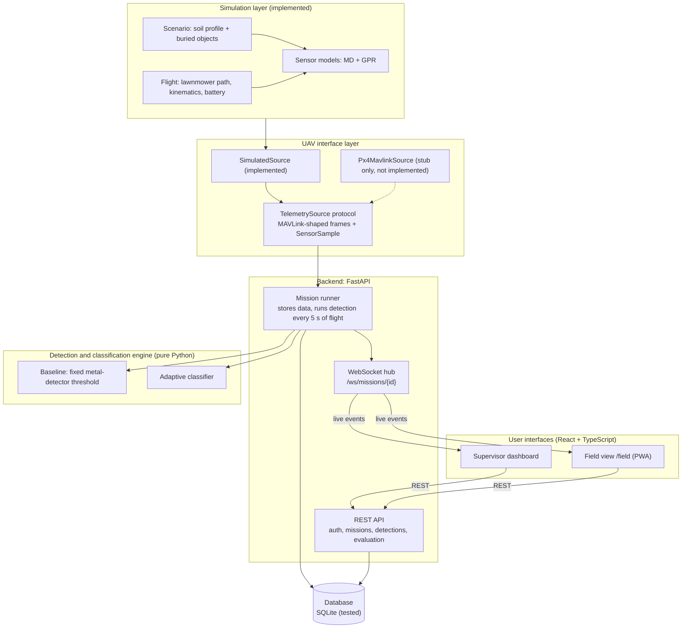
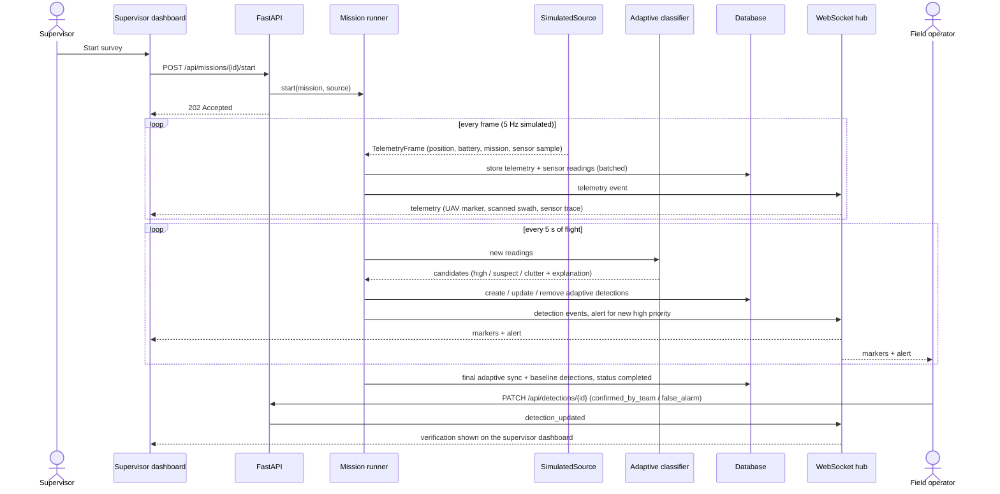
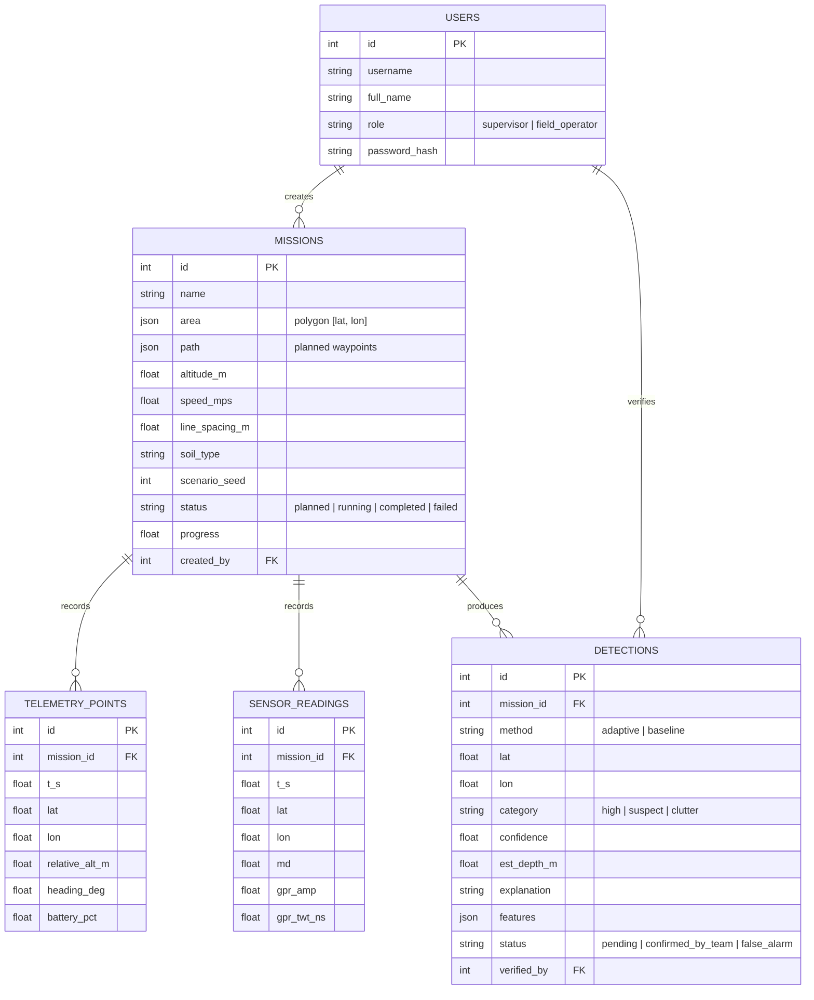
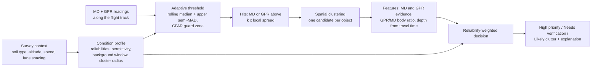

# System Architecture

This document describes the architecture of the UAV-Based Landmine Detection System prototype and can be used as
the basis for Section 4.1 of the project report. It separates what the prototype implements from the target
architecture that is planned but **not implemented** (see [Future Phases](#future-phases)).

All flights and sensor readings in the prototype are simulated. Every detection the system produces is a
*potential detection* that must be verified by trained personnel.

## 4.1 System Architecture

The system follows a layered architecture in which each layer depends only on the layer below it through a
narrow interface. The prototype has five layers:

1. **Simulation layer.** Generates a survey without flight hardware. It covers soil profiles, buried objects (the
   ground truth), a lawnmower flight path with simple UAV kinematics and battery drain, and synthetic metal-detector
   (MD) and ground-penetrating-radar (GPR) readings.
2. **UAV interface layer.** A `TelemetrySource` protocol is the only boundary between the UAV and the rest of the
   system. Flight data follows the field names and units of the MAVLink common message set
   (`GLOBAL_POSITION_INT`, `BATTERY_STATUS`, `MISSION_CURRENT`). Sensor data is a project-defined `SensorSample`,
   because GPR and MD readings are not MAVLink messages. The prototype implements `SimulatedSource`.
3. **Application layer (backend).** A FastAPI service with:
   - a REST API for authentication, missions, telemetry, detections, verification and evaluation;
   - a WebSocket hub that pushes live events to connected clients;
   - a background *mission runner* that consumes a `TelemetrySource`, stores the data and runs the detection
     engine while the UAV flies.
4. **Detection and classification engine.** A pure Python library with no web-framework or database
   dependencies. It contains a fixed-threshold baseline and the adaptive classifier (see
   [Adaptive detection pipeline](#adaptive-detection-pipeline)).
5. **Data layer.** SQLModel/SQLAlchemy tables using only portable column types. The prototype runs on SQLite.

Two user interfaces sit on top and talk to the backend only through REST and WebSocket:

- a **web dashboard** for the mission supervisor (planning, live monitoring, review, mission history, evaluation);
- a **mobile-first field view** (`/field`) for field personnel (alerts, nearest potential detections,
  verification), delivered as a Progressive Web App.

The main reason for this structure is replaceability. The simulator can be swapped for a real or PX4-simulated
UAV by adding another `TelemetrySource`. The detection engine can be tested on its own, or wrapped as a separate
service, without touching the rest of the system.

### Component diagram

### Live mission sequence

### Data model

### Adaptive detection pipeline

The same evidence is read differently in different conditions. A strong metal response without a matching radar
reflection is classified as likely clutter (small metal fragments) only where the radar is considered reliable.
Depth is estimated from the radar travel time using the soil's permittivity. Parameters were calibrated on tuning
seeds and frozen before evaluation; see [EVALUATION_PROTOCOL.md](EVALUATION_PROTOCOL.md) and
[EVALUATION_RESULTS.md](EVALUATION_RESULTS.md).

## Design decisions

| Decision | Rationale |
|---|---|
| `TelemetrySource` adapter between the UAV and the backend | The backend, engine, database and interfaces do not depend on where frames come from, so a PX4/MAVLink source can be added later without changing them. |
| MAVLink-shaped flight data, without ROS 2 in the core | The backend only needs position, battery and mission progress, which MAVLink provides directly. ROS 2 stays optional for a later sensor pipeline. |
| Detection engine as a pure library | It can be unit-tested and evaluated offline on thousands of simulated surveys, and could later be wrapped as a ROS 2 node or a separate service. |
| **Mobile access as a Progressive Web App** (`/field`), not a native app | One code base and one API serve the supervisor dashboard and the field view. The field view is mobile-first and installable from the browser. This was enough for the prototype's goals and the available time. A native Flutter app remains a future option on the same API. |
| WebSocket for live updates | Telemetry, detections and alerts change several times per second during a survey; pushing them avoids polling and keeps the supervisor and field screens consistent. |
| Portable database types; SQLite in the prototype | Polygons and feature maps are stored as JSON, so the schema is meant to run on PostgreSQL by changing `DATABASE_URL`. **This has not been tested on PostgreSQL.** |
| Simulation-based evaluation with a tuning / evaluation seed split | It allows repeatable, honest comparison of the baseline and the adaptive method; results are labelled as simulated. |

## Implementation status

| Component | Status in the prototype |
|---|---|
| Simulation (scenarios, flight, MD/GPR models) | Implemented and tested (PyTest) |
| `TelemetrySource` + `SimulatedSource` | Implemented and tested |
| FastAPI REST API, WebSocket hub, mission runner | Implemented and tested (PyTest + browser) |
| Baseline and adaptive classification | Implemented, calibrated on tuning seeds, evaluated on separate seeds |
| SQLite database | Implemented and tested |
| Supervisor web dashboard (React + TypeScript + Leaflet) | Implemented and tested in the browser |
| Field view `/field` | Implemented and tested in the browser at phone size. Web app manifest and icons added; service worker written but not verified; not yet installed on a real phone |
| Mission history page (counts per category, verification progress) | Implemented and tested in the browser |
| Evaluation page and generated results | Implemented |
| PX4 / MAVLink source | Stub only; see Future Phases |

## Future Phases

None of the items below is implemented in the prototype.

- **PX4 SITL + Gazebo through MAVLink.** Implement `Px4MavlinkSource` with MAVSDK-Python (e.g. `udp://:14540`),
  subscribing to position, velocity, heading, battery and mission progress. GPR/MD samples would arrive from the
  payload computer as a separate stream and be time-aligned with position before entering the system.
- **ROS 2 (optional).** Use it for the sensor pipeline if Gazebo sensor plugins are introduced. The detection
  engine can be wrapped as a ROS 2 node without changes to its logic.
- **Simulated control commands.** Takeoff, landing, pause, resume and return-to-launch would first be added as
  commands to the simulated UAV, then forwarded to a PX4 source. None of them is implemented; the dashboard can
  only plan and start a mission.
- **Multiple UAVs.** A `uavs` table and a `uav_id` on missions and telemetry would allow several UAVs in one
  system. Neither exists today; the prototype assumes one UAV per mission. Coordinated swarm behaviour is out of
  scope for this project.
- **Sharing field-team positions.** The field view uses the device location locally, for distances, but does not
  send it to the server.
- **Flutter mobile app.** A native app could use the same REST and WebSocket API as the PWA.
- **PostgreSQL + PostGIS.** The schema uses portable types, but the system has not been run on PostgreSQL, and no
  PostGIS spatial features are used yet.
- **Containers (Docker).** Not built or run in the prototype.
- **Real sensor data.** Calibrate the sensor models and the classifier against real MD/GPR measurements; the
  current parameters are tuned on simulated data only.
- **Production hardening.** Managed user accounts, secrets management, HTTPS, and deployment beyond a single
  development machine.
