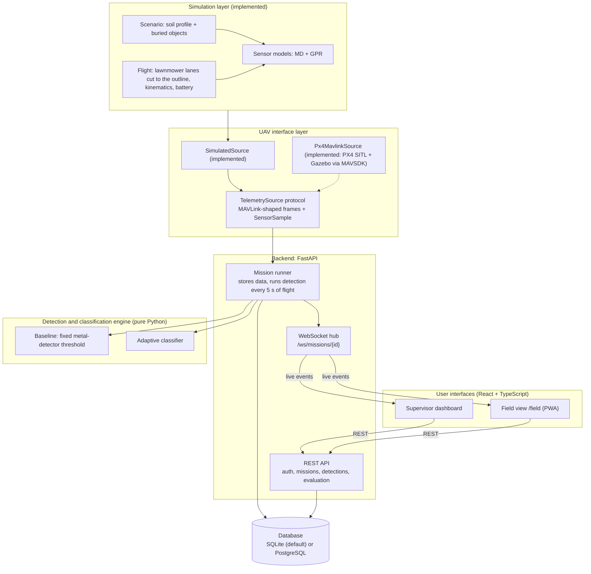
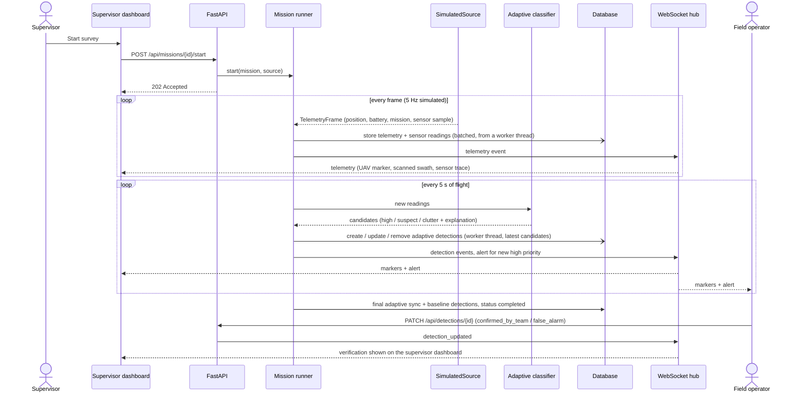
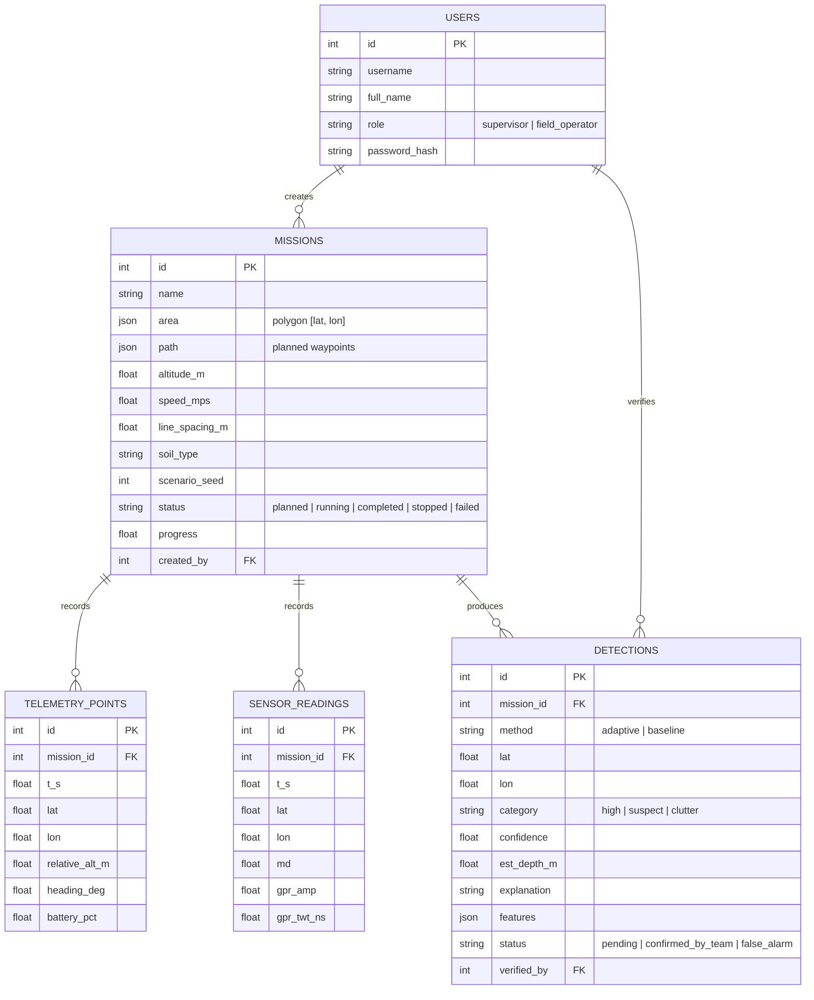
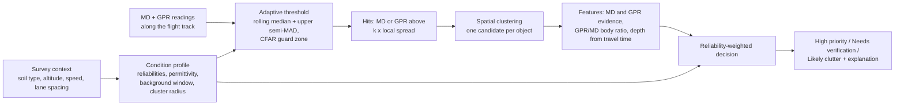

# System Architecture

This document describes the architecture of the UAV-Based Landmine Detection System prototype and can be used as
the basis for Section 4.1 of the project report. It separates what the prototype implements from the target
architecture that is planned but **not implemented** (see [Future Phases](#future-phases)).

All flights and sensor readings in the prototype are simulated. Every detection the system produces is a
*potential detection* that must be verified by trained personnel.

## 4.1 System Architecture

The system follows a layered architecture in which each layer depends only on the layer below it through a
narrow interface. The prototype has five layers:

1. **Simulation layer.** Generates a survey without flight hardware. It covers soil profiles, buried objects (the
   ground truth), a lawnmower flight path with simple UAV kinematics and battery drain, and synthetic metal-detector
   (MD) and ground-penetrating-radar (GPR) readings.
2. **UAV interface layer.** A `TelemetrySource` protocol is the only boundary between the UAV and the rest of the
   system. Flight data follows the field names and units of the MAVLink common message set
   (`GLOBAL_POSITION_INT`, `BATTERY_STATUS`, `MISSION_CURRENT`). Sensor data is a project-defined `SensorSample`,
   because GPR and MD readings are not MAVLink messages. The prototype implements `SimulatedSource` and
   `Px4MavlinkSource` (PX4 SITL + Gazebo over MAVLink, through MAVSDK), chosen per mission.
3. **Application layer (backend).** A FastAPI service with:
   - a REST API for authentication, missions, telemetry, detections, verification and evaluation;
   - a WebSocket hub that pushes live events to connected clients;
   - a background *mission runner* that consumes a `TelemetrySource`, stores the data and runs the detection
     engine while the UAV flies. It writes to the database from a worker thread, never in the event loop that sends
     the live events, so a database far away (a hosted PostgreSQL) cannot hold up the live view.
4. **Detection and classification engine.** A pure Python library with no web-framework or database
   dependencies. It contains a fixed-threshold baseline and the adaptive classifier (see
   [Adaptive detection pipeline](#adaptive-detection-pipeline)).
5. **Data layer.** SQLModel/SQLAlchemy tables using only portable column types. SQLite by default; PostgreSQL through `DATABASE_URL` (tested in Docker and used with a hosted one, Neon).

Two user interfaces sit on top and talk to the backend only through REST and WebSocket:

- a **web dashboard** for the mission supervisor (planning, live monitoring, review, mission history, evaluation);
- a **mobile-first field view** (`/field`) for field personnel (alerts, nearest potential detections,
  verification), delivered as a Progressive Web App.

The main reason for this structure is replaceability. The simulator can be swapped for a real or PX4-simulated
UAV by adding another `TelemetrySource`; `Px4MavlinkSource` does this for PX4 SITL + Gazebo. The detection engine can be tested on its own, or wrapped as a separate
service, without touching the rest of the system.

### Component diagram

### Live mission sequence

### Data model

### Adaptive detection pipeline

The same evidence is read differently in different conditions. A strong metal response without a matching radar
reflection is classified as likely clutter (small metal fragments) only where the radar is considered reliable.
Depth is estimated from the radar travel time using the soil's permittivity. Parameters were calibrated on tuning
seeds and frozen before evaluation; see [EVALUATION_PROTOCOL.md](EVALUATION_PROTOCOL.md) and
[EVALUATION_RESULTS.md](EVALUATION_RESULTS.md).

## Design decisions

| Decision | Rationale |
|---|---|
| `TelemetrySource` adapter between the UAV and the backend | The backend, engine, database and interfaces do not depend on where frames come from. The PX4/MAVLink source was added later with no change to the detection engine; the backend only gained the source choice per mission. |
| MAVLink-shaped flight data, without ROS 2 in the core | The backend only needs position, battery and mission progress, which MAVLink provides directly. ROS 2 stays optional for a later sensor pipeline. |
| Detection engine as a pure library | It can be unit-tested and evaluated offline on thousands of simulated surveys, and could later be wrapped as a ROS 2 node or a separate service. |
| **Mobile access as a Progressive Web App** (`/field`), not a native app | One code base and one API serve the supervisor dashboard and the field view. The field view is mobile-first and installable from the browser. This was enough for the prototype's goals and the available time. A native Flutter app remains a future option on the same API. |
| WebSocket for live updates | Telemetry, detections and alerts change several times per second during a survey; pushing them avoids polling and keeps the supervisor and field screens consistent. |
| Portable database types; SQLite by default | Polygons and feature maps are stored as JSON, so the same schema runs on PostgreSQL by changing `DATABASE_URL`. Tested on PostgreSQL 17 in Docker (all tests pass on it) and used with a hosted PostgreSQL (Neon). |
| Simulation-based evaluation with a tuning / evaluation seed split | It allows repeatable, honest comparison of the baseline and the adaptive method; results are labelled as simulated. |

## Implementation status

| Component | Status in the prototype |
|---|---|
| Simulation (scenarios, flight, MD/GPR models) | Implemented and tested (PyTest) |
| `TelemetrySource` + `SimulatedSource` | Implemented and tested |
| FastAPI REST API, WebSocket hub, mission runner | Implemented and tested (PyTest + browser) |
| Baseline and adaptive classification | Implemented, calibrated on tuning seeds, evaluated on separate seeds |
| Database: SQLite (default) or PostgreSQL | Implemented and tested on both |
| Supervisor web dashboard (React + TypeScript + Leaflet) | Implemented and tested in the browser |
| 3D view (`web/src/view3d/`, three.js) | Implemented and tested in the browser with the simulator (live and replay); a visual view of the same data as the map, in the backend's local metre frame. Not yet opened during a PX4 flight |
| Field view `/field` | Implemented and tested in the browser at phone size. Web app manifest and icons added; service worker written but not verified; not yet installed on a real phone |
| Mission history page (counts per category, verification progress) | Implemented and tested in the browser |
| Evaluation page and generated results | Implemented |
| PX4 / MAVLink source (`Px4MavlinkSource`) | Implemented and flown on small surveys with PX4 1.17.0 SITL (headless Docker image) and PX4 v1.18.0-beta1 SITL in Gazebo's window (WSL); see [PX4 SITL + Gazebo](#px4-sitl--gazebo). Not tried with a real vehicle; QGroundControl only by hand |

## PX4 SITL + Gazebo

The supervisor picks **Fly with: PX4 SITL** or **PX4 SITL + Gazebo window** before starting a survey
(`missions.uav_source` is `px4`; the window is chosen with each start). Then:

1. On the backend's PC, the chosen PX4 SITL is started at the takeoff point H when it is off or more than 2 m away,
   and the other one is stopped so that only one PX4 answers. PX4 SITL takes its home only when it starts, so this
   is how it takes off from H. `px4_docker.py` runs `docker stop` and `docker run` of the headless image;
   `px4_gazebo.py` feeds a fixed script to sh in WSL that starts PX4 with only Gazebo's server, then Gazebo's window
   (WSLg), and stops PX4 when the window closes. Both pass the coordinates as numbers. `PX4_MANAGE_DOCKER=0` turns
   this off.
2. The backend finds PX4 over MAVLink (MAVSDK, `udpin://0.0.0.0:14540`), waits for its GPS fix and home position,
   checks the area is within PX4's 900 m mission limit from home, and uploads the simulator's lawnmower path as
   mission items (mission height and speed, 0.5 m acceptance radius, starting at the first waypoint). If any of this
   fails the mission stays planned and the reason is shown. A vehicle left in Return mode is switched to Hold so it
   can arm.
3. PX4 arms, takes off and flies the lanes. Frames are built at 5 Hz from PX4's position, velocity, heading and
   battery. The waypoint being flown is taken from PX4's position, as MAVSDK's mission progress was empty with
   PX4 1.17.
4. On the survey lines, MD and GPR samples come from the project's sensor model at PX4's position, over the
   scenario's buried objects. On a real UAV they would come from the payload computer as a separate stream.
5. After the last waypoint PX4 flies at the survey height to the landing point L, or back to H, and lands there (a
   land mission item; return to launch only as a fallback). If the run is cancelled the backend commands return to
   launch; if the backend stops, PX4's link-loss failsafe returns and lands (observed).

## Flight controls

`POST /api/missions/{id}/control` (supervisor) sets the wanted phase on the mission's `FlightControl`
(`backend/app/uav/control.py`): surveying, paused, returning or landing. The source flying the mission reads it
between frames, so commands run in the source's own event loop (MAVSDK needs that):

| Command | Simulator | PX4 |
|---|---|---|
| Pause / Resume | one frame at rest, then no frames until resumed; the flight clock stops | Hold mode / mission start, which continues at the waypoint being flown to |
| Return Home | straight to the start of the path, then down at 0.5 m/s | return to launch |
| Land | down where it is at 0.5 m/s | land |

No sensor readings are taken while paused or on the way down. After Return Home or Land the run ends once the UAV
is down (PX4: disarmed), and the mission is stored as `stopped` with the reason; the detector's last update and the
baseline run on what was scanned. The phase is not stored: it comes with the mission while it runs (REST, WebSocket
snapshot and mission events).

## Future Phases

None of the items below is implemented in the prototype.

- **PX4 on a real vehicle, with real payload data.** The same MAVLink link as PX4 SITL, plus MD/GPR samples from
  the payload computer as a separate stream, time-aligned with position, instead of the sensor model at PX4's
  position. QGroundControl was only tried by hand.
- **ROS 2 (optional).** Use it for the sensor pipeline if Gazebo sensor plugins are introduced. The detection
  engine can be wrapped as a ROS 2 node without changes to its logic.
- **Simulated control commands.** Takeoff, landing, pause, resume and return-to-launch would first be added as
  commands to the simulated UAV, then forwarded to a PX4 source. None of them is implemented; the dashboard can
  only plan and start a mission.
- **Multiple UAVs.** A `uavs` table and a `uav_id` on missions and telemetry would allow several UAVs in one
  system. Neither exists today; the prototype assumes one UAV per mission. Coordinated swarm behaviour is out of
  scope for this project.
- **Sharing field-team positions.** The field view uses the device location locally, for distances, but does not
  send it to the server.
- **Flutter mobile app.** A native app could use the same REST and WebSocket API as the PWA.
- **PostGIS.** The system runs on PostgreSQL (tested with PostgreSQL 17 in Docker; SQLite stays the default), but
  no PostGIS spatial features are used yet.
- **Containers (Docker).** Built and run on a developer PC, with SQLite or PostgreSQL (sign-in and the demo scenario
  work); a hosted deployment of them is not tried.
- **Real sensor data.** Calibrate the sensor models and the classifier against real MD/GPR measurements; the
  current parameters are tuned on simulated data only.
- **Production hardening.** Managed user accounts, secrets management, HTTPS, and deployment beyond a single
  development machine. The security items are listed in
  [Security Hardening (Not Implemented)](#security-hardening-not-implemented).

### Security Hardening (Not Implemented)

The current version is a prototype and is not ready for public deployment. None of the following is implemented:

- **Login rate limiting and username timing.** There is no limit on failed login attempts. A login with an unknown
  username returns without hashing a password, so response time can reveal which usernames exist.
- **WebSocket Origin check.** `/ws/missions/{id}` does not check the `Origin` header (CORS does not apply to
  WebSockets).
- **API docs.** `/docs` and `/openapi.json` are open to anyone who can reach the server; they should be disabled or
  protected outside development.
- **HttpOnly cookie and HTTPS.** The web app keeps the access token in browser storage, readable by page scripts.
  An HttpOnly, Secure cookie served over HTTPS would replace it. The prototype runs over plain HTTP.
- **Security headers.** No Content-Security-Policy, Strict-Transport-Security or X-Frame-Options headers are sent.
- **Stronger password hashing.** Raise the PBKDF2 iteration count or move to Argon2.
- **Token revocation.** A token stays valid until it expires; there is no logout on the server, no revocation list
  and no way to end a user's sessions early.
- **Audit log.** Logins, mission starts and verification changes are not recorded in an audit trail
  (a detection keeps only its latest verifier).
- **Exception text in `Mission.error`.** When a mission run fails, the exception type and message are stored in
  `Mission.error` and sent to clients. They should be logged on the server and replaced with a generic message.
- **WebSocket token in the URL.** The token is passed as `?token=...`, so it can appear in server and proxy logs. It
  should move to a cookie or a first message after the connection opens.

### Verified Security Properties

These properties are implemented and were checked:

- **Roles are enforced on the server.** A field operator receives `403` on supervisor routes (create mission, start
  mission, run demo scenario). Covered by `test_field_operator_cannot_create_missions` and checked against the running
  backend for the other two routes.
- **Tampered or expired tokens are rejected.** Tokens are HMAC-SHA256 signed and carry an expiry time. A forged
  token gets `401` on the REST API and is refused by the WebSocket (`test_endpoints_require_a_token`,
  `test_websocket_rejects_bad_token`, `test_token_signed_with_the_old_default_secret_is_rejected`). Rejection of a
  modified payload and of an expired token was checked directly against `decode_token`; there is no PyTest test for
  the expired case.
- **Passwords are hashed with PBKDF2-HMAC-SHA256 and a random 16-byte salt per password** (200,000 iterations),
  compared in constant time.
- **No built-in signing key.** Commit `761ed7b` removed the default secret: if `SECRET_KEY` is not set, a random key
  is generated on first start and saved in `backend/.secret_key` (git-ignored). Tokens signed with the old default
  value are rejected (`backend/tests/test_secret_key.py`).
